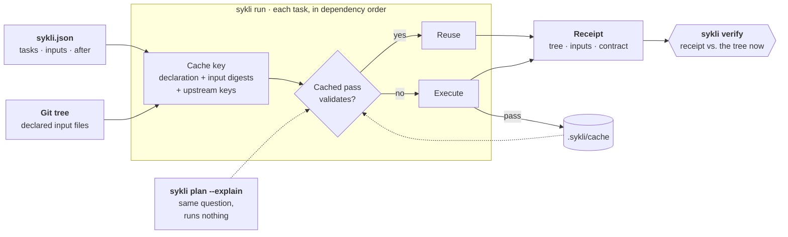

<h1 align="center">sykli</h1>

<p align="center"><em>sykli</em> — Finnish for <em>cycle</em></p>

<p align="center"><strong>Run your checks. Reuse the work. Explain the result.</strong></p>

<p align="center">
  
  
  
  
</p>

<p align="center">
  <a href="#see-it-in-30-seconds">Demo</a> ·
  <a href="#start-in-your-repository">Quick start</a> ·
  <a href="#how-it-works">How it works</a> ·
  <a href="#in-ci">CI</a> ·
  <a href="docs/agents.md">Agents</a> ·
  <a href="#command-map">Commands</a>
</p>

Sykli is one binary that turns your repository's checks into a **declared
graph**. It runs the graph in order, **reuses** any result whose inputs haven't
changed, and writes a **receipt** that ties every outcome to the exact tree it
ran against. It works the same on your laptop, in CI and for a coding agent.

Keep Cargo, npm, Go and your shell scripts. Sykli doesn't replace your tools. It
decides which of them need to run and keeps a verifiable record of what did.

## See it in 30 seconds

Two tasks, `lint` then `test`, each reading one script. Real output, hashes shortened:

```console
$ sykli run
running: lint
lint passed
passed: lint
running: test
tests passed
passed: test
receipt: …/.sykli/receipts/rcpt_4a80a5dc….json

$ sykli run                                   # nothing changed: nothing runs
cached: lint
cached: test
receipt: …/.sykli/receipts/rcpt_efdf9834….json

$ echo 'echo tests passed, again' > test.sh
$ sykli plan --explain                        # what would a run cost now?
lint
  selected: all tasks requested
  cache: available; receipt rcpt_4a80a5dc….json (restoration not attempted)
test
  selected: all tasks requested
  cache: no entry for the current key
Input coverage against 435c318a… (plus --changed hints):
  declared input: "test.sh" -> test
Unmapped paths are advisory except for missing Cargo inputs and undeclared tracked siblings of declared inputs, which block execution and cache reuse.

$ sykli run --json > .sykli/receipt.json      # only the changed task runs
cached: lint
running: test
tests passed, again
passed: test

$ sykli verify .sykli/receipt.json --contract sykli.json
ok: schema sykli-receipt.v1
ok: contract 8d0e65a0…
ok: tree 777d2ada…
ok: inputs e533f926…
ok: records consistent
ok: outcome passed with 2 task records
verified: receipt matches this tree and contract

$ echo 'echo sneaky' > lint.sh                # change the code after the fact…
$ sykli verify .sykli/receipt.json --contract sykli.json
ok: schema sykli-receipt.v1
ok: contract 8d0e65a0…
mismatch: tree expected a07b2a09… but got 777d2ada…
mismatch: inputs expected 834ffc9b… but got e533f926…
$ echo $?
3
```

Once the code changes, the old receipt no longer verifies. The whole graph is
[below](#a-graph-you-can-try); copy it and try this yourself.

## Start in your repository

Install from source with Rust 1.85 or newer:

```sh
cargo install --git https://github.com/false-systems/sykli --branch main --locked sykli
```

Then, in an existing Cargo, npm or Go repository:

```sh
sykli init                                        # detect ecosystems, write sykli.json, pin it in sykli.lock
sykli plan --explain                              # see selection and cache evidence, run nothing
sykli run --json > .sykli/receipt.json            # run the graph, keep the receipt
sykli verify .sykli/receipt.json --contract sykli.json
```

`init` creates `.sykli/` for local state and adds it to `.gitignore`. Review the
inputs it declares, especially configuration and fixtures, and declare files you
add later. Task execution needs Git, a POSIX `sh` and your project's own
toolchain. On Windows, Git for Windows supplies `sh`.

> [!NOTE]
> This README describes `main`. For a reproducible install, replace
> `--branch main` with `--rev COMMIT`. Tagged downloads will be listed on the
> [releases page](https://github.com/false-systems/sykli/releases) once
> published, and [install.sh](install.sh) verifies their checksums. Installing
> Sykli does not install your build tools.

## How it works



It comes down to three things:

| | What it is | Where it lives |
|---|---|---|
| **Contract** | The work you declare: tasks, commands, the files each one reads, and what runs `after` what. | `sykli.json`, pinned by `sykli.lock` |
| **Receipt** | One evaluation: commands, outcomes, output digests, and which results were reused. | `.sykli/receipts/` (and wherever you redirect `--json`) |
| **Verify** | A check that a receipt is consistent with the tree and contract in front of you. | `sykli verify` |

**Reuse is earned, not assumed.** A task's cache key covers its declaration,
the contents and execute bits of its declared inputs, the runtime fingerprint,
digests of inherited environment values, and the cache keys of every task it
runs `after`. A downstream task never reuses a pass recorded against upstream
outputs it did not see, and a matching entry must validate before it is used.
In a Cargo graph the runtime fingerprint also covers the Rust toolchain the
task shell resolves (`rustc -vV`, `cargo -V`), so a pass recorded under one
compiler is not reused under another.

### A graph you can try

In a scratch Git repository:

```sh
printf 'echo lint passed\n' > lint.sh
printf 'echo tests passed\n' > test.sh
```

```json
{
  "schema": "sykli-contract.v1",
  "tasks": [
    { "name": "lint", "run": "sh lint.sh", "inputs": ["lint.sh"] },
    { "name": "test", "run": "sh test.sh", "inputs": ["test.sh"], "after": ["lint"] }
  ]
}
```

`inputs` names the files a task reads. `after` makes `test` wait for `lint` and
binds its cache key to that dependency. Independent tasks run in parallel.

Every path a task declares (`inputs`, `outputs`, `workdir`) is relative to the
repository and stays inside it. Absolute paths and `..` are refused when the
contract is validated, before anything runs, so a receipt is always a claim
about the repository it sits in, even when the contract is kept
[outside it](#keep-the-contract-outside-the-repository). `sykli validate`
checks a contract without running it.

<details>
<summary><strong>What a task sees when it runs</strong></summary>

<br>

Tasks run under `sh -c` with no stdin. They receive `PATH`, `HOME` and `TMPDIR`,
plus declared `env` values and named `inherit` variables. Inherited values reach
the task, but only their digests reach the receipt, where they count toward the
task's identity. A declared value may name `${worktree_cache}`, a directory of
the worktree's own
([one build directory per worktree](#one-build-directory-per-worktree)). Task
output is captured, so commands are responsible for what they print. Sykli runs
local commands with your permissions.

</details>

## Ask before you run

`plan --explain` tells you what a run would do and what the cache can supply,
without running anything:

```sh
sykli plan --explain
sykli plan --changed test.sh --explain
sykli plan --changed test.sh --explain --json
sykli plan --explain --base origin/main --json
sykli plan --explain --preview --json          # inspect a contract edit before re-locking
```

It reads `sykli.json` by default; an explicit JSON contract path selects another
graph. It runs no task or Rust emitter, restores no outputs, and writes no cache
entries or receipts.

| Cache state | What it tells you |
|---|---|
| `available` | Cached evidence and artifacts validate; a run can attempt reuse. |
| `missing` | No entry exists for the current content key. |
| `invalid` | An entry exists, but its evidence or artifacts failed validation. |
| `deferred` | A dependency needs execution, restoration or error resolution first. |
| `input_error` | A declared input cannot currently be evaluated. |

**Undeclared files are flagged.** Explain warns about changed files that no task
lists as an input, even when every task is already selected. It checks staged,
unstaged and untracked non-ignored files, and `--base origin/main` adds
committed changes relative to that ref. Contract and lock changes are labeled as
evaluation metadata. In Cargo-root repositories, `run` refuses to execute or
reuse passes when known source, configuration or test files in the current Git
inventory are missing from every task's inputs. In every graph, it also refuses
an undeclared sibling of a declared input: a tracked file directly inside a
folder that holds one of a task's inputs, which that task does not declare.
That catches a fixture added next to declared fixtures, once it is `git add`ed.
It is a tripwire, not a dependency scan. It does not catch files in new
subfolders or in parent folders, anything in the repository root, or
untracked, ignored and generated files. Other unmapped paths are advisory.

> [!IMPORTANT]
> Sykli does not observe every file or tool your commands read. An undeclared
> dependency can make a cached result misleading, and selecting every task does
> not prove every dependency is declared. An explanation describes the current
> local evidence, not a guaranteed outcome. See
> [the coverage limits](docs/agents.md).

`--changed` takes paths **you supply** and filters the displayed plan to
matching inputs and their downstream tasks. It does not discover a Git diff and
does not restrict a later `run`, which evaluates the whole graph and decides
reuse from content keys.

## Runs that survive a crash

On Linux and macOS every `sykli run` is durable. Before any task starts, the
run is recorded in the clone's git directory,
`$(git rev-parse --git-common-dir)/sykli/runs/<run-id>/`, so it outlives the
worktree that started it. Each task's attempts are then recorded as they
happen: dispatched before its shell is spawned, started, and finished with
its exit code or signal and its captured output. The run id is printed first
(`run: ID`, on stderr with `--json`) and is the receipt's `run`.

```sh
sykli run sykli.json --json             # the receipt names its run
sykli status --run RUN_ID               # what is known about the run, at any time
sykli resume --run RUN_ID               # continue a run whose coordinator ended
sykli run sykli.json --detach --json    # {"schema":"sykli-run.v1","run":"…"} once recorded
```

`run --detach` answers once the run is recorded, and hands it to a coordinator
in its own session. That coordinator, and so every task it runs, keeps none
of the caller's descriptors: a caller reading the command's output to its end
sees it end when `run` returns, not when the run does.

A crash leaves exactly what was observed, and nothing more:

- A task whose end was recorded keeps its outcome: passed, failed, errored,
  cached or blocked.
- A task whose attempt was dispatched but whose end was not recorded is
  **lost**. Its outcome is unknown and it is never passed, even if its process
  later exited 0 with nobody watching. While that process still runs, the
  task is **running**: the shell and its children hold the attempt's lease,
  and the process group the journal recorded for the attempt still exists. A
  process that closes the lease's descriptor (as `sudo` does) is still seen
  through its group; one that also leaves the group (`setsid`) is not seen at
  all. A group id the system has reused for an unrelated process reads as
  running too: never lost too early.
- On SIGINT, SIGTERM or SIGHUP, the run stops each running task's process
  group, records it **interrupted** (not failed, and never passed: whatever
  it exits with answers the signal, so a task that traps it and exits 0 is
  interrupted too), writes no receipt, and exits 128+N. Each task runs in its
  own process group, so a signal sent to sykli reaches it through sykli.
  Outcomes recorded before the signal are kept, and `sykli resume` concludes
  the run.
- A stop sent to a task directly as well (a `kill` of a process group or
  session that holds both, or a service manager stopping a whole control
  group) is covered as far as sykli sees it. An attempt that ends after
  sykli's own signal handler ran, or passes less than 100 ms before, is
  interrupted: a pass already recorded for it is **withdrawn**, and so is
  every pass decided after it (a dependent reused from the cache may rest on
  it), and a resume runs them again. So that this holds for the last task
  too, a run waits, before it concludes, until 100 ms have passed since the
  last task it ran passed: at most 100 ms per run, and none when nothing ran.
  A failure is never withdrawn (it is never a false pass). A pass that came
  earlier keeps its outcome, and a signal that never reaches sykli is not
  seen at all.
- The receipt is built only from recorded outcomes and written durably, and
  only then is the run **completed**.

`sykli status --run ID --json` (`sykli-run-status.v1`) gives the run's state
(`requested`, `running`, `completed`, `interrupted`, or `lost` when its
coordinator ended without concluding it), its subject (tree, commit when
clean, dirty), the contract and lock digests, each task's state and every
attempt (id, started, finished, exit, signal, outcome, what it supersedes,
whether its outcome was withdrawn, and what stopped it), and the receipt
(path, in the file system's spelling however the repository was named, and
digest) once complete. A run also keeps a copy of its receipt in its own
directory, `sykli/runs/<run-id>/rcpt_<sha256>.json`, written durably before
the run is recorded completed. Status reports it as `receipt.kept` (`path`,
`present`). The copy outlives the worktree that ran the run: after a
disposable checkout is removed, `status --run` from any other worktree of the
clone still names it, `verify KEPT --commit REV` judges it, and `status
--commit` counts it. It goes when the run is pruned. Status reads the journal
and its locks, runs no git once the repository is known, and writes nothing. A run removed by the run
budget answers that it was pruned, with what it was, from the tombstone the
budget leaves (`sykli/pruned-runs/`).

`sykli resume --run ID` takes over a run whose coordinator ended. Tasks with
a recorded outcome are kept, failed ones included. Each lost or interrupted
task is retried as a new attempt that supersedes the old one, which stays in
the history. Resume is refused while the run's coordinator, or a process of
one of its attempts, is still alive (its lease is held, or its process group
still exists; `--assume-ended` overrides the group check when that id now
belongs to an unrelated process), and when the worktree's source, the
contract, its lock or the runtime is not what the run recorded: its receipt
would then claim a tree that did not produce it. Each coordinator that takes
a run over opens a new generation, and every record carries its generation,
so a coordinator that lost its lease cannot later complete an attempt or
conclude a run that a newer one has taken over: its first refused write
fences it off, and it writes nothing more.

A resumed task runs **at least once**, and possibly more than once: a lost or
interrupted attempt may have run to completion, and done whatever it does,
before its end went unrecorded. `resume` says so on stderr for each task it
runs again whose last attempt had started (`warning: re-running TASK: …`).
A task with side effects, such as a deployment, must be safe to repeat, or
be checked before a resume.

A task whose declared inputs change while the run is in progress is
`errored` (class `input_changed`), never passed: what it read is not the
tree the run recorded.

`sykli status --commit REV --json` (`sykli-commit-status.v1`) asks what the
receipts of a commit's tree say, judged with the code `verify --commit`
uses. Like `verify`, it does not establish that their tasks ran: an outcome
is the receipt's claim. Every receipt of `REV`'s tree that this clone keeps
(this worktree's, those the pre-push hook kept, and those of runs, from any
worktree, where they were written or as the run kept them) is judged
for `REV`. Those that verify now, passed or failed, are `current`; the others
of that tree are `historical`, shown but never current evidence: another
contract or an edited record (`not-applicable`, `unverifiable`), or a
receipt whose run this clone keeps (or pruned, or cannot read) but which did
not conclude with it (`unconcluded`, `unrecorded`). Receipts bind trees, not
commits: a pass for one commit is current for every commit with the same
tree, and for no other.

A current receipt is `recorded` when its run concluded with it in this
clone's journal. The `verdict` follows one rule: **a failure is never hidden
by a pass**. The newest recorded result for the tree and contract decides (a
run that concluded failed counts even when its receipt is gone), so a rerun
that passes after a failure is `passed`, and a failure after a pass is
`failed`. A receipt no run recorded has only the time it claims: a pass of
that kind never outranks a recorded failure, and a failure it claims after
the newest recorded pass is not ignored. Either way the verdict is
`conflict`, and `conflict` says why. With no recorded result, the newest
receipt decides. The verdict is `pending` while a run of the tree is in
progress and nothing else decides, and `none` otherwise. The runs of the
tree are listed with their states and each task's attempts (`["lost",
"passed"]`: the pass came only after a lost attempt; a receipt's `retried`
names such tasks), and a run whose journal cannot be read is named in
`unreadable_runs`, never skipped silently.

`sykli verify --json` prints the verdict as one `sykli-verify.v1` document:
every check, the first failing stage, the exit code (unchanged), and what the
verdict establishes (`schema`, `contract`, `source`, `consistency`) and does
not (`outcome`, `provenance`, `producer`, `execution`). An outcome is the
receipt's claim: receipts are unsigned, and an outcome rewritten with
consistent digests verifies. A failed outcome still exits 1.
`claimed_outcome` is the receipt's own `outcome` as it records it (`passed`,
`cached`, `failed`, `errored`), or null when the receipt cannot be read: the
claim, given as a field so a caller need not read the human `actual` text of
the outcome check.

The journal is local and unsigned, trusted like the receipts, and claims no
authenticity. Each record is synced with `fsync(2)` before it is acknowledged.
On macOS that is not `F_FULLFSYNC`: a power cut on a drive that ignores
`fsync` can lose the last records, a process crash or a kernel panic cannot.
Durable runs need Unix file locks. On Windows a run keeps everything in memory
until its receipt is written, as before, and `--detach`, `status --run` and
`resume --run` are unavailable.

## One build directory per worktree

A task's declared `env` values may name `${worktree_cache}`, a directory that
belongs to the worktree the run is in:

```json
{
  "name": "test",
  "run": "cargo test --workspace --locked",
  "inputs": ["Cargo.toml", "Cargo.lock", "src/main.rs"],
  "env": {
    "CARGO_TARGET_DIR": "${worktree_cache}/cargo-target",
    "CARGO_BUILD_BUILD_DIR": "${worktree_cache}/cargo-build"
  }
}
```

It expands to `$(git rev-parse --git-common-dir)/sykli/worktrees/<id>/cache`.
`<id>` (16 hex digits) identifies one incarnation of the worktree: its top
level, its own git directory, and a token sykli keeps in that git directory
(`sykli-incarnation`). Sykli makes the directory when a run needs it. It is
the same on every run in that worktree, and different in every other
worktree. A worktree removed and made again at the same path gets a new
directory: git gives it the same git directory, but deletes the old token
with the old worktree. It lies outside the work tree, so it never shows in
`git status` or in a tree a receipt binds. The directory belongs to the
tasks: sykli keeps its own records beside it, in `<id>/`, so a task may empty
or remove it (`cargo clean`), and the next run makes it again.

**Recommended for Rust contracts: declare both variables.** When every
worktree of a clone shares one Cargo target directory (`[build] target-dir`
in `~/.cargo/config.toml`, or a `CARGO_TARGET_DIR` set for everything), the
final artifacts land in shared `debug/<name>` paths. A gate in one worktree
can then run a binary that another worktree built. Cargo may find the other
worktree's build fresh and build nothing, or another build may replace
`debug/<name>` while the gate's tests run it. The receipt then claims a pass
for code that never ran.

- `CARGO_TARGET_DIR=${worktree_cache}/cargo-target` moves the final
  artifacts.
- A shared `[build] build-dir` (Cargo 1.91 and later) holds the intermediate
  ones: dependencies, fingerprints and test binaries. With
  `CARGO_TARGET_DIR` alone, a gate still finds another worktree's build fresh
  there. `CARGO_BUILD_BUILD_DIR=${worktree_cache}/cargo-build` moves those
  too. A Cargo without `build-dir` ignores it.
- Both take precedence over Cargo's configuration, so each gate builds in its
  own worktree's directory. Your own `cargo` commands keep the shared ones.

**What it costs:**

- The first gate in each worktree builds cold. Later gates there are
  incremental.
- Each worktree keeps build directories of its own on disk until it is gone.
- Adding the lines changes the contract's digest, so receipts from before
  them read as another contract's.
- A sykli older than this one hands `${worktree_cache}` to the task as
  written, and Cargo then builds in a `${worktree_cache}/` directory inside
  the work tree. Adopt the lines once every sykli that runs the contract
  knows them.
- On Windows, paths under `.git\sykli\worktrees\<id>\cache\` are about 50
  characters longer than under an in-tree `target\`, which counts against
  `MAX_PATH` (260) for tools that do not use long paths. If a build hits it,
  enable long paths (the `LongPathsEnabled` policy, and `core.longpaths` for
  git), or keep the clone's path short.

**The cache key covers the declaration, never the directory.** The key
contains `${worktree_cache}` as written, not the path it expands to. A pass is
evidence about the inputs it ran with, and a build in a directory that no
other worktree writes is a build of those inputs. So:

- Identical work in two worktrees has the same key.
- A worktree you move keeps its cached passes.
- A pass earned with a shared directory is never reused once the contract
  declares `${worktree_cache}`, because the declaration changed.

Sykli records the directory nowhere, in no receipt and no journal. A task's
own captured output may name it: `cargo test` prints the paths it runs.

The directory keeps worktrees apart by accident, not by force: its path can
be computed, and any process that can write the common git directory can
write into it, just as it can write receipts.

**Where a contract is written or run** (`validate`, `lock`, `plan`, `run`,
`resume`, the pre-commit hook), these are refused: `validate` exits 1, and
the others exit 2.

- In an `env` value, any `${…}` other than `${worktree_cache}`, or an unclosed
  one. Such a value is never passed on literally. A `$` that opens no `${`
  is kept as written (`$ORIGIN`, `$LINENO`).
- In an `env` value, `$${`. It is reserved for an escape of `${`, so that
  adding one later never changes what a valid contract means. There is no
  escape for a literal `${` yet.
- `${worktree_cache}` (or `$worktree_cache`) anywhere but an `env` value: in
  `run`, `workdir`, `inputs`, `outputs` or an env name. Sykli does not expand
  it there, and a shell would make it empty. Declare it in `env` and use the
  variable.

**Where a contract is judged** (`verify`, `status --commit`, the pre-push
hook), none of these apply. A commit whose contract an earlier sykli ran with
`"PS4": "+${LINENO}: "` keeps the verdict its receipt earns.

On Linux and macOS a run holds the directory's lease. So do its tasks that
name it, and whatever they start. When a run is recorded in any worktree of
the clone, sykli sets aside the directory of every worktree incarnation that
is gone, but never one whose lease is held. An incarnation is gone once its
worktree was removed, moved, made again, or pruned by git, unless git keeps it
locked (`git worktree lock`, for a worktree on removable media). The run
deletes what it set aside once its work is done, so a large directory never
delays its start. On Windows the directories are made but never pruned:
remove `sykli/worktrees/` in the common git directory yourself, when no run
is live.

## In CI

After checkout, install Sykli and your project's toolchain, then:

```sh
mkdir -p .sykli
sykli run --json > .sykli/receipt.json
sykli verify .sykli/receipt.json --contract sykli.json
sykli verify .sykli/receipt.json --contract sykli.json --commit HEAD
```

Fail the job on any command's nonzero exit and keep the receipt as an
artifact. On pull requests, check out the pull request's head
(`ref: ${{ github.event.pull_request.head.sha }}` on `actions/checkout`), not
GitHub's merge commit, so the receipt is evidence for the commit that gets
merged. The Action verifies against that head by default; its `commit` input
overrides that. The included [GitHub Action](action.yml) runs and verifies the graph,
writes a job summary, uploads the receipt, and reports which tasks a pull
request affects. It installs a release tag, so pin it with
`uses: false-systems/sykli@vX.Y.Z` once one is published. This repository gates
itself through the Action on every pull request.

<details>
<summary><strong>Measuring smarter CI: the shadow experiment</strong></summary>

<br>

On pull requests, this repository runs a [shadow experiment](docs/ci-shadow.md).
It records the changed paths and runs the full candidate graph, then compares
that result with the reuse proposed by a separate run of the base commit. It
reports agreements, disagreements, unmapped paths and the task time that could
have been reused.

**All required checks still run.** The experiment measures whether skipping
could be justified later. It does not claim CI savings today, and matching
observations do not prove that declarations are complete.

</details>

## Git hooks

A run checks the files on disk. A commit carries what is staged. The hooks
check what is committed:

```sh
sykli hook install            # both hooks; --pre-commit or --pre-push for one
```

`install` writes a three-line `#!/bin/sh` hook that calls `exec sykli hook NAME "$@"`.
It writes into the repository's common git directory, so every worktree shares
the hooks, and `sykli` must be on `PATH` wherever git runs. It does not replace
a hook it did not write, or one of its own that was edited, unless you pass
`--force`, which keeps the old hook as `NAME.pre-sykli`. Running it again is
safe.

- `sykli hook pre-commit` refuses the commit when a tracked file has changes
  that are not staged, or an untracked file is not ignored, because the run
  would then check a tree other than the commit's. Otherwise it runs and
  verifies the graph, and last compares the tree that ran with the tree the
  index will commit (`git write-tree`), so a file marked assume-unchanged or
  skip-worktree cannot carry other content past it. It stashes nothing. A tool
  that writes a temporary file beside an ignored one (`name.json.tmp-*` next to
  an ignored `name.json`) trips the untracked-file refusal while it writes;
  the fix belongs in that tool: write temporary files into an ignored
  directory.
- `sykli hook pre-push` refuses a push that moves the remote's default branch
  unless this worktree holds a receipt that passes
  `sykli verify --commit` for the pushed commit. It looks in
  `.sykli/receipt.json` and `.sykli/receipts/`. The default branch is the one
  `refs/remotes/REMOTE/HEAD` names, or else `main` and `master`. That is a
  guess: git never moves `refs/remotes/REMOTE/HEAD` after the host renames its
  default branch, and the branch you protect need not be the default. Name the
  gated branches with `--branch NAME`, repeated for more than one, and the hook
  gates exactly `refs/heads/NAME` for each and guesses nothing. Without
  `--branch`, a `refs/remotes/REMOTE/HEAD` that names a ref that no longer
  exists counts as unknown: `main` and `master` are gated, and a note says so.
  Deletions, tags and pushes to other branches pass. A refusal names the
  command that produces a receipt: `sykli run sykli.json` with the commit
  checked out, or `sykli lock` first when the contract differs from its lock.
  Cached tasks make that run quick, and the run the pre-commit hook made
  already counts.
- When the hook accepts a push to the default branch, it copies the receipt
  that verified it into the repository's common git directory, as
  `$(git rev-parse --git-common-dir)/sykli/receipts/rcpt_<sha256>.json`, named
  like `.sykli/receipts/`. That is where accepted pushes' evidence is kept: a
  worktree's `.sykli/` goes with the worktree, this does not. To show later
  that a pushed commit was verified, find a kept receipt whose
  `subject.tree_oid` is `git rev-parse COMMIT^{tree}`, then run
  `sykli verify RECEIPT --contract sykli.json --commit COMMIT`. That verify is
  required, not optional: the directory confers no trust, and anyone who can
  write the repository can write a file there. A kept receipt is evidence for
  the commit, not proof that the commit reached the remote: the hook runs
  before the remote answers, and git runs it for `git push --dry-run` too.
  To know the remote has it, check
  `git merge-base --is-ancestor COMMIT REMOTE/BRANCH`. The copy is written
  atomically and never through a symbolic link; if it cannot be made, the
  hook warns and the push goes ahead. Keeping a receipt again, for a commit
  pushed again, makes it the newest, so eviction does not take it first.
- Whether a push is gated is decided from the commits, not the working tree.
  The pushed commit's own `sykli.json` gates it. A commit without one is refused
  when the branch it replaces had one, so taking the gate off main is a
  deliberate `git push --no-verify`. When the remote's default branch is
  unknown, a note says so and suggests `git remote set-head REMOTE --auto`.

A commit with no `sykli.json` or `sykli.rs`, pushed where there was none
before, passes with a note.

## Keep the contract outside the repository

A contract does not have to be committed. You can keep a repository's
contract, and the `sykli.lock` that pins it, in a directory of your own, for
example under your configuration, and name it on every command:

```sh
cd ~/src/project                       # anywhere inside the repository
gate=~/.config/gates/project/sykli.json
sykli init --contract "$gate"          # infer tasks from the repository; write the contract and lock there
mkdir -p .sykli                        # init --contract creates nothing in the repository
sykli run "$gate" --json > .sykli/receipt.json
sykli verify .sykli/receipt.json --contract "$gate" --commit HEAD
```

When the contract lies outside the git repository around the current
directory:

- The repository is that directory's git toplevel, never the contract's
  directory. The contract's `inputs`, `outputs` and `workdir` are paths from the
  repository's root, as in a committed contract, and the undeclared-sibling
  check and the Cargo completeness gate apply as usual. Paths you type, such as
  `plan --changed`, mean what they mean where you type them.
- A task may depend only on files in the repository, which it declares, and
  on tools it finds on `PATH`. Files kept beside an outside contract, such as
  a helper script a task runs, cannot be declared and are not hashed, so
  changing one does not invalidate a cached pass. Keep such helpers in the
  repository and declare them, or install them as tools.
- The lock is the `sykli.lock` beside the contract as you name it, as always,
  and `sykli lock "$gate"` writes it there. For a contract named through a
  symbolic link that is the lock beside the link: when there is none there but
  the link's target has one, the contract runs unpinned and sykli warns.
- Receipts and the cache stay in the repository's `.sykli/`. `init --contract`
  touches nothing in the repository, so it neither creates `.sykli/` nor adds
  it to `.gitignore`; ignore it in your global git ignore
  (`core.excludesFile`) instead.
- `verify` reads the contract and its lock from their files, with or without
  `--commit`, since no commit carries them; the `--commit` checks on the
  commit's tree are unchanged. A receipt from another version of the contract
  exits 4 (`contract`). Every receipt also records `lock_digest`, the SHA-256
  of the lock file it ran with (null without one), and for a contract outside
  the repository verify requires the receipt's `lock_digest` to match the lock
  file beside the contract now, or exits 4 (`lock`). Without a lock on either
  side, they match, and the contract hash alone binds the receipt. The digest
  covers the whole lock file, which holds one entry per contract in its
  directory, so keep one contract per directory: locking a second contract
  beside the first changes the file and refuses the first one's receipts.
- `sykli hook pre-commit --contract PATH` runs that contract on the staged
  tree, and `sykli hook pre-push --contract PATH REMOTE URL` gates pushes with
  it, whatever the pushed commits carry. Name the branches it protects with
  `--branch NAME` (repeat it for more than one); without it, the hook gates the
  default branch it guesses, as described [above](#git-hooks). A contract
  inside the worktree that the pushed commit does not carry cannot be
  verified, and the hook says to keep it outside the worktree or commit it.
  A hook you write yourself, or one shared by all your repositories, can call
  them:

```sh
#!/bin/sh
exec sykli hook pre-push --contract "$HOME/.config/gates/project/sykli.json" --branch main "$@"
```

Accepted pushes' receipts are kept in the common git directory as described
[above](#git-hooks).

A hook runs on every push, so sykli asks git as little as it can: it finds
the repository with one `git rev-parse` per command, and `hook pre-push`
answers everything about the pushed commits with one `git cat-file --batch`,
reading receipts as files and building no snapshot of the working tree. A
caller that already knows the repository can pass `--repo-root` and
`--git-common-dir` (as `git rev-parse --path-format=absolute --show-toplevel
--git-common-dir` prints them) to any command, and then sykli runs no git to
find it. They are checked from files: the root's `.git` must lead to the
common directory, or the command exits 2, since a subdirectory given as the
root would leave changes outside it out of the snapshot. With them, `hook
pre-push` starts one git process in all, `verify --commit` one, and `run`
five; `hook pre-push` and `verify --commit` start one more, `git cat-file
--filters`, for each declared input a checkout converts (line endings, a
smudge filter), and only for such an input.

## Built for agents

The CLI does the querying, and `--json` gives scripts and agents the same
answers. Every machine-readable document has a versioned schema, and
incompatible changes get a new version. Exit codes are part of each command's
contract and are printed in its `--help`. The loop an agent runs is the one you
run:

```sh
sykli plan --changed PATH --explain --json    # which tasks does this change need?
sykli run --json                              # run them, get a sykli-receipt.v1
sykli verify RECEIPT --contract sykli.json    # does that receipt still describe this tree?
```

Read the [agent guide](docs/agents.md) for selection reasons, JSON fields and
error behavior.

## Beyond checks

### Build artifacts and resume unfinished work

On Linux and macOS, typed production captures declared source, builds an
artifact and runs the required checks. A production ID lets another terminal
or agent resume from the same local store.

```sh
sykli init --production --smoke '"$SYKLI_INPUT_executable" --help'
sykli targets
sykli produce TARGET --stop-after build
sykli resume PRODUCTION_ID
```

Use the target name and production ID that Sykli prints. Stopping after build
exits 1 while checks remain. Artifact availability and completed checks are
recorded separately. Failed work requires an explicit retry, and an unresolved
lost attempt cannot silently become a success. See
[the production agent loop](docs/agents.md) for preparation without execution,
bounded parallel work and diagnostics. A production's `delivery` field says the
artifact is in the local store; it says nothing about any deployment.

### Deliver an artifact, and say only what is observed

On Linux and macOS, `sykli deliver` puts a produced artifact on a target and
records the operation so that a crash leaves a true record. Sykli knows nothing
about any kind of target. A `sykli-delivery-contract.v1` (default
`sykli.delivery.json`) names, per target, the product it receives and the
commands **you** own: `apply` does the side effect, `observe` prints what the
target reports, `smoke` is optional, and `identity` says what the target will
report for the artifact:

```json
{
  "schema": "sykli-delivery-contract.v1",
  "production": "sykli.production.json",
  "targets": {
    "staging": {
      "artifact": {"target": "app", "product": "image"},
      "identity": {"kind": "command", "run": "./deploy/identify.sh"},
      "apply": {"run": "./deploy/apply.sh", "inherit": ["DEPLOY_TOKEN"]},
      "observe": {"run": "./deploy/observe.sh"},
      "smoke": {"run": "./deploy/smoke.sh"},
      "freshness_seconds": 120,
      "settle_seconds": 90
    }
  }
}
```

```sh
sykli produce app
sykli deliver --target staging            # prints `delivery: ID` first
sykli status --delivery ID                # judged again, now; nothing runs
sykli observe --delivery ID               # observe the target now; never applies
sykli resume --delivery ID [--reapply]    # after a crash: reconcile first
sykli deliver --target staging --rollback-to EARLIER_ID
```

- **Only a complete production is delivered,** with its artifact available in
  the store. `identity` is `{"kind": "content"}` (the artifact's own SHA-256) or a
  command that prints what the target will report for it, such as the manifest
  digest inside an image archive.
- **The commands run as a run's tasks do:** `sh -c` in the contract's
  directory, with a cleared environment plus `PATH`, `HOME` and `TMPDIR`, the
  declared `env`, and the `inherit`ed variables. An inherited value reaches only
  the command that declares it, and only its digest reaches the journal. Each
  command also gets `SYKLI_DELIVERY` (the id; write it to the target so an
  observer can name it), `SYKLI_INTENDED` and `SYKLI_DELIVERY_TARGET`. `apply`
  also gets `SYKLI_ARTIFACT` (the artifact, materialized) and
  `SYKLI_DELIVERY_ATTEMPT`. Sykli redacts nothing a command prints: it keeps
  each apply's output (at most 64 KiB per stream), the first 4 KiB of every
  command's stderr, and each observation, so a command must never print a
  secret.
- **The order is durable.** The delivery is recorded before anything runs, and
  the apply is recorded as dispatched before its shell starts. An apply that
  exits 0 is **acknowledged**: the target accepted the change, which is not a
  deployment. Then `observe` runs (until the target settles, at most
  `settle_seconds`), and every observation is recorded with its time and the
  digest of what the observer printed.

`observe` prints a `sykli-observation.v1`, integers only:

```json
{"schema": "sykli-observation.v1", "reachable": true, "present": true, "uid": "…",
 "desired": {"revision": "8", "artifact": "sha256:…", "operation": "<the delivery id>", "writer": "…"},
 "observed": {"revision": "8", "artifacts": ["sha256:…"], "converged": true},
 "readiness": {"ready": 2, "wanted": 2},
 "checks": [{"name": "…", "passed": true}],
 "controller": {"state": "complete", "reason": "…"},
 "token": "…"}
```

`reachable: false` (with a `reason`) is itself an observation: the controller
could not be reached. `desired` is what the target is asked to run, `observed`
what it runs, by immutable digest; `controller.state` is `pending`,
`progressing`, `complete`, `failed` or `unknown`.

**The verdict has dimensions, never one "succeeded".** `sykli status --delivery
ID --json` (`sykli-delivery-status.v1`) judges, at the moment it is asked:

| | Dimension | What it compares |
|---|---|---|
| A | operation | requested, dispatched, applying, acknowledged, apply-failed, lost, unknown, acknowledgement-lost; superseded by a later delivery to the target |
| B | artifact | the intended identity against what runs (`match`, `partial`, `mismatch`, `none-running`) |
| C | desired | whether the target's desired state is this delivery's (or modified out of band, rolled back, someone else's) |
| D | observed | the observed revision against the desired one, converged |
| E | health | readiness, the observer's checks, the smoke command |
| F | freshness | the observation's age against `freshness_seconds`, and any later delivery |

The label is **VERIFIED HEALTHY** only when B matches, D equals C, E passes and
F is fresh, and the desired state is the one this delivery's own apply put
there. Otherwise it is **NOT VERIFIED HEALTHY** (rollout incomplete, apply
failed, superseded, changed out of band), **DEGRADED** (a failed check or smoke, the controller's own failure,
the target missing), **UNKNOWN** (the apply's end or the target is unknown) or
**STALE** (the evidence is too old to say anything about now), with the reasons.
A passing smoke check or a healthy old replica never makes it healthy: B must
match.

**A lost acknowledgement is never answered by applying again.** If the
coordinator dies after the apply was dispatched but before its end was
recorded, `sykli resume --delivery ID` observes the target. When the target's
desired state is this delivery's artifact (and names this delivery, when the
target keeps an operation id), the attempt is recorded "acknowledgement lost,
effect observed"; otherwise its effect is recorded **unknown**, and only
`--reapply` applies again, as a new attempt that supersedes the old one, which
stays in the history. The journal itself refuses
any second apply that was not asked for, or that came before that
reconciliation. An apply that was never dispatched is simply dispatched.

What a delivery's status rests on is printed with it: a trusted local
coordinator and journal, and each observation as the declared observer reported
it, never independently verified. A delivery is no controller either: sykli
never re-applies to keep a target in shape, it only runs the commands you
declared when you ask, and says what was observed.

### Inspect pull-request evidence

With an authenticated GitHub CLI (`gh`), collect CI and review evidence for an
exact candidate and assess it against requirements you declare:

```sh
sykli inspect --repo OWNER/REPO --pr NUMBER --requirements review.json
sykli assess BUNDLE --requirements review.json
```

The requirements file names exact workflow and reviewer IDs. Sykli saves the
collected responses, so an assessment can be replayed offline. Each requirement
comes back **established**, **refuted** or **unproven**, with the gaps and
excluded evidence behind it. An approval of an older commit does not count as
approval of the current candidate.

Assessments are advisory. They establish declared review-readiness conditions,
not permission to merge or deploy. `inspect` makes bounded, read-only requests
through `gh`. It never posts reviews or triggers work.

## What a receipt proves, and what it doesn't

`verify` runs in stages, and the first stage that fails decides the exit code:

| Exit | Meaning |
|---|---|
| `0` | Receipt matches, and the work passed or was reused. |
| `1` | The recorded work failed. |
| `2` | The receipt cannot be verified. |
| `3` | The tree or declared inputs differ from the receipt's (changed since the run, or, with `--commit`, not that commit's), or, with `--commit`, the run read an input the commit cannot show. |
| `4` | The contract or lock differs. |

A receipt is a JSON file. It is not signed, and anyone who can write the
checkout can edit it. So a successful `verify` says three different things,
and it is worth keeping them apart:

- **What verify establishes.** The receipt's schema is valid. Its records are
  consistent with each other and with the contract (each recorded command is
  the contract's, a passed task exited 0). The contract and lock are the ones
  named. The tree, and every declared input's bytes and execute bit, are the
  ones the receipt claims: read from the checkout, or with `--commit` from the
  commit itself, never taken from the receipt. An input a checkout converts
  (line endings, a smudge filter) is compared with what a checkout of the
  commit makes of its blob, and the output says so.
- **What it does not establish.** Where the receipt came from. Who produced it.
  That its tasks were observed running, or ran at all. Anything a task read
  that is not a declared input: the toolchain, the environment, undeclared
  files. With `--commit`, the bytes of an input a task declares as an
  output: the run generated it and the commit cannot have it, so its bytes
  are the receipt's claim, like an outcome, and only the inputs of the task
  that produces it are established (the output names it). A receipt is a
  claim that is consistent with the tree and contract, not evidence that the
  work happened. It also does not prove that the declared checks are
  sufficient.
- **What that leaves open.** Someone who edits a receipt and keeps it
  consistent still passes:
  - a failing run's receipt with its outcome rewritten to "passed", every
    digest left as it was (a test pins this);
  - a receipt written for a commit from scratch, with that commit's own input
    records and digests: every digest a receipt records follows a public
    formula, so this takes only the commit's bytes, and it claims an outcome
    nobody observed;
  - a converted input, which is bound only as the commit's own
    `.gitattributes` and the verifier's configuration convert it. That
    configuration includes `.git/info/attributes` and `core.attributesFile`:
    whoever can write it can also name a smudge filter that writes any bytes,
    so it is trusted like the rest of the configuration. A receipt from a
    checkout configured differently (an autocrlf checkout on Windows,
    verified on Linux) is refused.

  Editing fewer fields gets no further. The tree, and each input's entry,
  bytes and execute bit, are read from the commit, so a passing receipt for
  one commit with another commit's tree and entries copied in is refused.
  Only authenticated execution evidence, a signed record from something
  trusted to have watched the run, could tell an honest receipt from a
  consistent forgery, and sykli has none. Treat a verified receipt as
  consistent, not as proven.

A receipt binds a tree, not a commit, and a run of uncommitted work is only
marked `dirty`. To ask whether a receipt is evidence for a commit, name it:

```sh
sykli verify .sykli/receipt.json --contract sykli.json --commit HEAD
```

With `--commit REV`, the subject is the commit, not the checkout. The
contract and its `sykli.lock` pin are read from `REV` (from their files for a
contract [outside the repository](#keep-the-contract-outside-the-repository),
which no commit carries). The receipt's tree must be `REV^{tree}`, and every
declared input the run read must be what `REV` has at its exact path. A
receipt records, for each task's inputs, what its run read: the SHA-256 of the
bytes, the execute bits, and the tree entry (mode and blob) its own snapshot
had at that path. `verify --commit` reads each input's entry and blob from the
commit, in the same single `git cat-file` it already uses, and requires the
recorded entry to be the commit's, the recorded bytes to be the blob's, and
the recorded execute bit to be the entry's. Where a checkout converts the file
(line endings, a smudge filter), the bytes the run read are not the blob's,
and they are compared with what `git --attr-source=REV cat-file --filters`
makes of the blob, as a checkout of `REV` would: by the commit's own
`.gitattributes`, never the checkout's, and this repository's configuration
(including `.git/info/attributes`). That is one more git process, only for
such an input, and needs git 2.40 or later (`--attr-source`); with an older
git, such an input cannot be checked and `verify --commit` exits 2. The
blob is hashed as it is read, so a large input costs sykli time, not its size
in memory. The records must also hash to the receipt's inputs digest, with
or without `--commit`. A receipt edited to name another commit's tree,
with one input's record or path changed, or with another commit's tree and
entries copied in, exits 3. No input is read from the checkout, so any
commit can be verified from any checkout, uncommitted edits or not. A run
need not be clean: a pre-commit run, made before HEAD
moves, is a run of exactly the tree the commit records and counts for the
push. Whether the run was clean is still reported. On any failure, the first
failing check is also printed to stderr as one line.

Each declared input is judged at its exact path, as `REV:PATH` names it: git
does not fold case or Unicode normalization there, follow a symbolic link on
the way, or look inside a submodule. The path is the declared one from the
top level, by its names alone, never resolved through the checkout, so a
symbolic link in the checkout cannot point a declared input at another file.
What the commit cannot show is never passed unjudged:

- A file the run read where the commit has nothing at that path (an ignored
  or untracked file, a name spelled differently from git's, a file inside a
  submodule or reached through a symbolic link to a directory) cannot be
  judged, and the receipt is refused (exit 3) with the reason. Declare
  inputs as git spells them, and keep files a commit cannot carry out of a
  contract you verify against commits.
- An input neither the run nor the commit has is judged absent on both sides.
- An input a task declares as an output (or that lies under a directory it
  declares) is generated by the run, so the commit is not expected to have
  it. It is reported as not judged: its bytes are the receipt's claim, and
  only the inputs of the task that produces it are judged.
- A symbolic link is judged by its entry, the target's name, and by the
  bytes read through it, which must be those of the declared input it names.
  A link whose target no task declares is refused: declare both. A `..` in a
  target may only leave the link's own directories: after a name the target
  gives, the file system resolves `..` through whatever that name is (a link
  to a directory included), so the names cannot say which file was read, and
  such a link is refused. A checkout
  without symbolic links (`core.symlinks=false`, common on Windows) holds a
  file with the target's name instead, other bytes than the link gives, so
  a run that read that is refused too.
- The execute bit is the one git has: the owner's execute bit where the file
  system has execute bits, and the bit already in the tree where git does not
  trust them (`core.filemode=false`) or there are none (Windows).

A receipt written before per-task input records is checked by recomputing its
inputs digest from the commit's files, trying an executable file's usual
modes and never an execute bit the commit does not have. Where a declared
input is not a regular file in the commit, a checkout converts it, or the
run's file system had no execute bits for an executable file (Windows), that
cannot be done, and it exits 3. Run sykli again for a receipt that records
its inputs.

Without `--commit`, verify judges the checkout as it is now. Run both in CI: a
run hashes its tree before its tasks execute, so only the live check notices a
task that leaves an undeclared file behind.

A tree records a submodule only as the commit it is at. When a submodule has
uncommitted changes, tracked or untracked, the run is marked `dirty` and
records `submodules_modified: true`, and `--commit` refuses that receipt with
exit 3.

A receipt also records **when**. `started_at_ms` on the run is when that run
began; on a task, it is when that task was seen running. A cached task replays
its original moment, so a receipt full of cache hits reports old task times
under a new run time, which is an accurate record of what happened. Neither
field is part of any cache key.

Keep receipts under `.sykli/` or outside the repository, so that they don't
change the tree they describe.

## What Sykli keeps on disk

The cache, the receipts, runs, deliveries and production scratch are bounded, and each limit is stated:

| State | Limit | Override |
|---|---|---|
| Task cache | **1 GiB**; least recently used entries are dropped when a run would go over | `SYKLI_CACHE_BUDGET_BYTES` (`0` keeps everything) |
| Receipts | **200**; oldest removed first, never one that a live cache entry cites | `SYKLI_RECEIPT_BUDGET` (`0` keeps every receipt) |
| Receipts of accepted pushes, in the common git directory | **200**; oldest removed first, never the one just kept | `SYKLI_RECEIPT_BUDGET` (`0` keeps every receipt) |
| Runs, in the common git directory | **100** runs, each with its tasks' captured output (at most 1 MiB per stream per attempt) and a copy of its receipt; when a run starts, the oldest are removed, concluded ones first, never a run whose coordinator is alive; each removed run leaves a tombstone of a few hundred bytes (its state, tree and receipt), at most **1000**, oldest removed first | `SYKLI_RUN_BUDGET` (`0` keeps every run) |
| Worktree directories (`${worktree_cache}`), in the common git directory | **One per worktree incarnation** whose contract names it, holding whatever its tasks put there (Cargo build directories can be gigabytes); set aside when a run starts once its worktree is gone or made again (unless git keeps it locked) and deleted when that run is done, never while a run in that worktree holds its lease. Not pruned on Windows (remove them by hand when no run is live) | — |
| Production attempts | Working directories removed (best effort) once outputs are collected | — |
| Deliveries, in the common git directory | **100** deliveries per clone; when one is requested, the oldest settled ones are removed: never one whose coordinator or apply is alive, whose apply's effect is still unknown (a resume needs it), or the newest delivery to any target, so the count can exceed the budget by those. Each holds at most **2000** journal records (observing stops there), each apply's output (at most 64 KiB per stream), and the artifact only while an apply runs | `SYKLI_DELIVERY_BUDGET` (`0` keeps every delivery) |

Both budgets are enforced when a run **starts** as well as when it stores. A
production command first sweeps the working directories of any attempt that no
executor holds, so a run killed mid-attempt is cleaned up by the next one. A
receipt that a live cache entry cites is never evicted, because a cached result
whose receipt is gone would be a claim with nothing behind it. Losing a cache
entry costs a re-run, never a result.

## Command map

| | Command | What it does |
|---|---|---|
| **Graph** | `init` | Detect Cargo, npm and Go; write `sykli.json` and pin it (`--contract` writes it outside the repository) |
| | `validate` | Check a contract without executing it |
| | `lock` | Re-pin a contract's hash in `sykli.lock` after you edit it |
| | `plan` | Select the tasks a change requires; `--explain` shows why and what's cached |
| | `run` | Execute the graph and record a receipt; durable on Linux and macOS (`--detach` hands it off) |
| | `status --run` · `resume --run` | Read a run's journal; continue a run whose coordinator ended |
| | `status --commit` | Judge every kept receipt of a commit's tree for that commit: current and historical |
| | `verify` | Check a receipt against the current tree and contract; `--commit` ties it to a commit; `--json` |
| | `hook` | Git hook entrypoints that gate what is committed and pushed |
| **Production** | `targets` | Discover typed artifact targets without building |
| | `produce` | Build an artifact from captured source and run its checks |
| | `status` · `resume` | Inspect or continue a production by ID |
| | `diagnostics` · `verify-production` | Read an attempt's diagnostics; check a production record |
| **Delivery** | `deliver` | Apply a produced artifact through your commands and judge it from observations (`--detach`, `--rollback-to`) |
| | `status --delivery` · `observe` · `resume --delivery` | Judge a delivery now; observe its target again; reconcile after a crash (`--reapply` to apply again) |
| **Evidence** | `inspect` | Collect a pull request's runs and reviews through `gh` |
| | `assess` | Assess a saved evidence bundle, offline and deterministically |

Every command documents its flags and exit codes in `sykli <command> --help`.

## Learn more

- [Agent guide](docs/agents.md): JSON queries, explanations, production and assessment
- [CI experiment](docs/ci-shadow.md): methodology, artifacts and limitations
- [Changelog](CHANGELOG.md): version history
- [Contributing](CONTRIBUTING.md) and [product boundaries](AGENTS.md)
- [Security policy](SECURITY.md): report vulnerabilities privately

<p align="center"><sub>Part of False Systems · <a href="LICENSE">MIT</a></sub></p>
