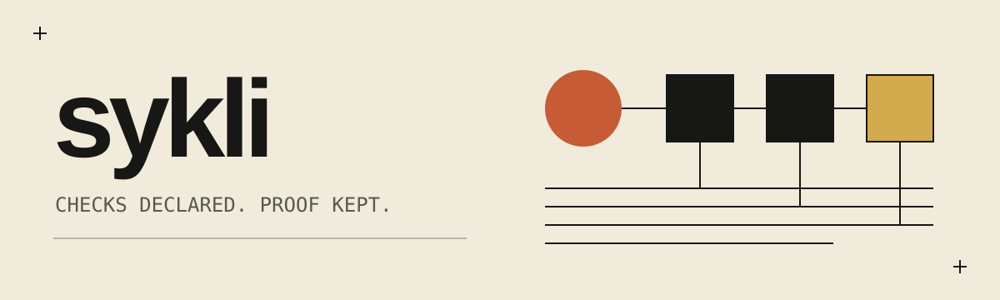

# sykli

Sykli is one binary that runs your repository's checks as a declared graph
and keeps proof of what passed. *Sykli* is Finnish for *cycle*.

Most repositories know their checks only as a list of commands in a CI file.
Nobody can say which of them a change needs, whether last night's pass still
holds, or what exactly was tested. Sykli makes the checks a graph you declare:
each task names its command and the files it reads. It runs the graph in
order, reuses any result whose inputs have not changed, and writes a receipt
that ties every outcome to the exact tree it ran against. It works the same on
your laptop, in CI and for a coding agent.

Keep Cargo, npm, Go and your shell scripts. Sykli does not replace your tools.
It decides which of them need to run and keeps a verifiable record of what did.

## See it

Two tasks, `lint` then `test`, each reading one script. Real output, hashes
shortened:

```console
$ sykli run
running: lint
passed: lint
running: test
passed: test
receipt: …/.sykli/receipts/rcpt_18b86d1f….json

$ sykli run                                   # nothing changed: nothing runs
cached: lint
cached: test

$ sykli verify .sykli/receipt.json --contract sykli.json
ok: tree 777d2ada…
ok: outcome passed with 2 task records
verified: receipt matches this tree and contract

$ echo 'echo sneaky' > lint.sh                # change the code after the fact
$ sykli verify .sykli/receipt.json --contract sykli.json
mismatch: tree expected a07b2a09… but got 777d2ada…
refused: tree expected a07b2a09… but got 777d2ada…
```

Once the code changes, the old receipt no longer verifies. The
[reference](docs/reference.md#see-it-in-30-seconds) has the whole run and the
graph, to copy and try.

## Install

From source, with Rust 1.85 or newer:

```sh
cargo install --git https://github.com/false-systems/sykli --branch main --locked sykli
```

This version is not on crates.io yet. Once it is published,
`cargo install sykli --locked` installs it; until then, use the command above.

Running tasks needs Git, a POSIX `sh` and your project's own toolchain. On
Windows, Git for Windows supplies `sh`.

## Use

In a Cargo, npm or Go repository with at least one commit, in the order you
meet them:

```sh
sykli init             # detect the ecosystems, write sykli.json and pin it
sykli plan --explain   # which tasks a change needs and what is cached; runs nothing
sykli run              # run the graph and write a receipt
sykli verify RECEIPT --contract sykli.json   # does a receipt still match this tree?
sykli hook install     # refuse a commit or a push that has no passing receipt
```

From a proven commit to production, on Linux and macOS:

```sh
sykli review           # a fresh agent reviews the change: fine, look or blocking
sykli land             # push a proven, reviewed commit to the default branch
sykli deploy           # run deploy.json for a landed commit and record it
sykli deployed         # what went out to each target, and when
```

`sykli <command> --help` documents every flag and exit code.

## How it works

| | What it is | Where it lives |
|---|---|---|
| **Contract** | The work you declare: tasks, commands, the files each one reads, and what runs after what. | `sykli.json`, pinned by `sykli.lock` |
| **Receipt** | One evaluation: commands, outcomes, output digests, and which results were reused. | `.sykli/receipts/` |
| **Verify** | A check that a receipt is consistent with the tree and contract in front of you. | `sykli verify` |

A task's cached pass is reused only when its declaration, the contents of its
declared inputs, the toolchain and everything upstream are unchanged. Receipts
bind a tree, not a commit: a pass for one commit holds for every commit with
the same tree, and for no other.

## What it does not do

- It does not replace your build tools or install them.
- It does not see files a command reads but the task does not declare. An
  undeclared input can be served from cache.
- A receipt is a record, not a signature. It shows that the tree and contract
  match; it does not prove who ran the tasks or that they ran.
- A review is a model's judgement, recorded with who gave it. It is not proof
  that the change is correct.
- It runs no server and keeps no state outside the repository and its Git
  directory.

## More

- [Reference](docs/reference.md): every command, the cache, durable runs, hooks, review, land and deploy.
- [Local checks before committing and pushing](docs/reference.md#local-checks-before-committing-and-pushing): set up the hooks in an existing repository.
- [Agent guide](docs/agents.md): JSON queries, explanations and commit status for coding agents.
- [Changelog](CHANGELOG.md), [contributing](CONTRIBUTING.md) and [security policy](SECURITY.md).
- [Licence](LICENSE): MIT.
